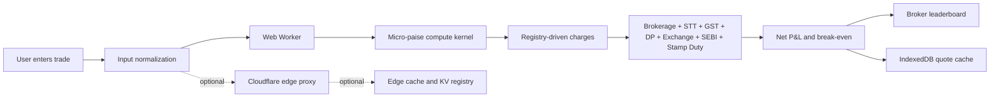

# 🌉 TradeSetu

### Know the real cost before you trade.

TradeSetu is a Pan-India, zero-backend brokerage and statutory charge calculator. It compares the cost of equity delivery, intraday, futures, and options trades locally in the browser, with an optional stateless Cloudflare edge proxy.

[](https://react.dev/) [](https://www.typescriptlang.org/) [](https://vitejs.dev/) [](https://tailwindcss.com/) [](https://vitest.dev/) [](https://pages.cloudflare.com/)

## Features

| Feature | Description |
|---|---|
| Local calculations | Core quotes run in a Web Worker with no backend dependency. |
| Precise money | Paise are canonical; percentage math uses BigInt micro-paise arithmetic. |
| Full charge breakdown | Brokerage, STT, exchange, SEBI, stamp duty, GST, and DP charges. |
| Broker comparison | Compare up to 25 registry-defined brokers by total charges. |
| Offline-first cache | Anonymous quote fingerprints and results are cached in IndexedDB for 24 hours. |
| Age-inclusive UI | Junior, standard, and senior experiences for ages 13–80. |
| Optional edge proxy | Stateless Cloudflare Worker validation, ETags, KV registry, and edge caching. |

## Quick Start

Requirements: Node.js 18+ and npm 9+.

```bash
npm install
npm run dev
```

Open `http://localhost:5173`.

## Scripts

| Command | Purpose |
|---|---|
| `npm run dev` | Start the Vite development server. |
| `npm run build` | Type-check and create the production bundle. |
| `npm run preview` | Preview the production bundle. |
| `npm run typecheck` | Run strict TypeScript checks for the frontend. |
| `npm test` | Run frontend and edge Vitest suites. |
| `npm run edge:dev` | Run the optional edge worker locally without deployment. |

## Architecture



See [docs/ARCHITECTURE.md](docs/ARCHITECTURE.md) for implementation boundaries and data flow.

## Supported Segments

- Equity delivery
- Equity intraday
- Futures
- Options

## Charges Calculated

Brokerage, Securities Transaction Tax (STT), exchange transaction charges, SEBI turnover fee, stamp duty, GST, Depository Participant (DP) charges, total charges, break-even movement, and estimated net profit or loss.

## Accessibility Modes

- **Junior, 13–17:** simplified language, larger type, and a listen action.
- **Standard, 18–59:** compact full calculator experience.
- **Senior, 60–80:** extra-large readout, high contrast, and speech support.

Every control is keyboard accessible, results use live regions, and the interface respects reduced-motion preferences.

## Project Structure

```text
tradesetu/
├─ src/                 # Vite frontend, worker, calculator, UI, and cache
├─ tests/               # Frontend unit and integration tests
├─ edge/                # Optional Cloudflare Worker and edge tests
├─ docs/                # Architecture and operational documentation
├─ index.html
├─ package.json
└─ vite.config.ts
```

## Deployment

### Cloudflare Pages

```bash
npm run build
npx wrangler pages deploy dist --project-name tradesetu
```

### Optional Cloudflare Worker

Configure the production KV namespace ID and allowed origin in `edge/wrangler.toml`, then deploy from the repository root:

```bash
npx wrangler deploy --config edge/wrangler.toml
```

Do not commit secrets or production credentials. The frontend remains fully functional if the edge worker is unavailable.

## Testing

```bash
npm run typecheck
npm test
npm run build
npm run edge:dev
```

The test suite covers money precision, normalization, deterministic computation, worker request correlation, IndexedDB behavior, age-adaptive UI, and edge protocol behavior.

## Privacy

The primary calculation flow is local and zero-backend. Trade inputs are not sent anywhere by the frontend calculation path. IndexedDB stores only normalized quote inputs, anonymous fingerprints, registry versions, timestamps, and computed results. No personal data, API keys, tokens, sessions, or IP addresses are stored.

## Disclaimer

TradeSetu provides estimates only. Actual brokerage, taxes, statutory levies, exchange charges, and DP charges may vary by broker, contract type, exchange, state, and applicable regulations. Always verify final charges with your broker's official contract note. TradeSetu is not financial advice.

## Contributing

1. Fork the repository.
2. Create a feature branch: `git checkout -b feature/your-change`.
3. Install dependencies and run the checks above.
4. Make a focused change with tests where behavior changes.
5. Open a pull request describing the change and verification.

## License

TradeSetu is released under the [MIT License](LICENSE).
