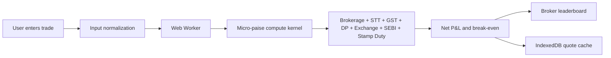

<div align="center">

# 🌉 TradeSetu

### Know the real cost before you trade.

**TradeSetu** is a Pan-India, zero-backend brokerage and statutory tax calculator.
It helps traders compare the true cost of equity delivery, intraday, futures, and options trades across brokers — instantly, privately, and offline-first.

[](https://react.dev/)
[](https://www.typescriptlang.org/)
[](https://vitejs.dev/)
[](https://tailwindcss.com/)
[](https://pages.cloudflare.com/)
[](#license)

[✨ Features](#-features) •
[🚀 Quick Start](#-quick-start) •
[🧮 How It Works](#-how-it-works) •
[♿ Accessibility](#-accessibility) •
[☁️ Deployment](#️-deployment) •
[🤝 Contributing](#-contributing)

</div>

---

## ✨ Features

| Feature | Description |
|---|---|
| ⚡ **Instant Calculations** | Buy price, sell price, quantity, segment, and exchange are calculated in real time. |
| 🧮 **Micro-Paise Precision** | Uses integer-based micro-paise arithmetic to avoid floating-point rounding errors. |
| 🏦 **Complete Charge Breakdown** | Brokerage, STT, exchange transaction charges, SEBI fees, stamp duty, GST, and DP charges. |
| 🏆 **Broker Leaderboard** | Compare up to 25 brokers by lowest estimated total cost. |
| 🔒 **Zero-Backend Privacy** | Core calculations run locally in the browser using a Web Worker. |
| 📴 **Offline-First Cache** | Recent quotes are cached in IndexedDB for fast repeat calculations. |
| ♿ **Age-Inclusive UI** | Adaptive experience for users aged 13–80, including junior and senior modes. |
| 🗣️ **Voice Readout** | Senior mode can read results aloud using browser speech synthesis. |
| 🌐 **Optional Edge API** | A stateless Cloudflare Worker provides validation, fingerprinting, and edge caching. |

---

## 🚀 Quick Start

### Prerequisites

- Node.js **18+**
- npm **9+**

### Install and run

```bash
git clone [https://github.com/your-username/tradesetu.git](https://github.com/your-username/tradesetu.git)
cd tradesetu
npm install
npm run dev
```

Open:

```text
http://localhost:5173
```

### Build for production

```bash
npm run build
npm run preview
```

### Run tests

```bash
npm test
```

### Type checking

```bash
npm run typecheck
```

---

## 🧮 How It Works



### Supported segments

- Equity Delivery
- Equity Intraday
- Futures
- Options

### Charges calculated

- Brokerage
- Securities Transaction Tax (STT)
- Exchange transaction charges
- SEBI turnover fees
- Stamp duty
- GST
- Depository Participant (DP) charges

---

## ♿ Accessibility

TradeSetu is designed for users aged **13 to 80**.

| Mode | Age group | Experience |
|---|---:|---|
| 🧒 **Junior Mode** | 13–17 | Simplified explanations, larger text, and a listen button. |
| 🧑 **Standard Mode** | 18–59 | Compact, fast, full-featured calculator interface. |
| 👴 **Senior Mode** | 60–80 | Extra-large print, high-contrast option, and voice readout. |

Accessibility controls include:

- Age-based adaptive UI
- High-contrast mode
- Voice readout
- Keyboard-friendly controls
- Screen-reader-friendly result announcements
- Reduced-motion support

---

## 📁 Project Structure

```text
tradesetu/
├─ src/
│  ├─ components/
│  ├─ hooks/
│  ├─ lib/
│  ├─ types/
│  ├─ workers/
│  ├─ data/
│  └─ styles/
├─ tests/
├─ edge/
├─ index.html
├─ package.json
├─ vite.config.ts
├─ tailwind.config.ts
└─ tsconfig.json
```

---

## ☁️ Deployment

### Deploy frontend to Cloudflare Pages

```bash
npm run build
npx wrangler pages deploy dist --project-name tradesetu
```

### Optional: deploy edge worker

```bash
cd edge
npx wrangler deploy --config wrangler.toml
```

The frontend works fully without the edge worker. The edge service is optional and adds server-side validation, quote fingerprinting, and Cloudflare edge caching.

---

## 🛠️ Available Scripts

| Command | Description |
|---|---|
| `npm run dev` | Start the local development server |
| `npm run build` | Type-check and create a production build |
| `npm run preview` | Preview the production build locally |
| `npm test` | Run unit tests |
| `npm run typecheck` | Run TypeScript checks |
| `npm run edge:dev` | Run the optional Cloudflare Worker locally |
| `npm run edge:deploy` | Deploy the optional Cloudflare Worker |

---

## ⚠️ Disclaimer

TradeSetu provides **estimates only**. Actual brokerage, taxes, statutory levies, exchange charges, and DP charges may vary by broker, contract type, exchange, state, and applicable regulations. Always verify final charges with your broker’s official contract note.

---

## 🤝 Contributing

Contributions are welcome!

1. Fork the repository.
2. Create a feature branch:
   ```bash
   git checkout -b feature/your-feature
   ```
3. Commit your changes:
   ```bash
   git commit -m "Add: your feature"
   ```
4. Push the branch:
   ```bash
   git push origin feature/your-feature
   ```
5. Open a Pull Request.

---

## 📄 License

Released under the [MIT License](LICENSE).

---

<div align="center">

### 🌉 TradeSetu

**Know the real cost before you trade.**

Made with ⚡ for Indian traders.

</div>
