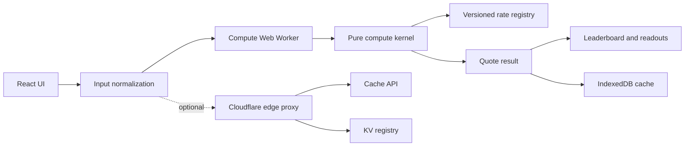

# TradeSetu Architecture

## Product Overview

TradeSetu estimates brokerage and statutory trading costs for Indian equity delivery, equity intraday, futures, and options trades. The product compares broker outcomes while keeping the primary calculation path local, deterministic, and usable offline.

## Zero-Backend Principle

All primary calculations happen locally in the browser. The UI normalizes input, sends a typed request to a Web Worker, and receives a registry-driven result without requiring an API or account. The optional edge worker adds validation and caching but is never required by the core calculator.

## Data Flow

## Money Precision Strategy

Money is stored canonically in integer paise. Precision-sensitive percentage operations convert paise to BigInt micro-paise, apply basis-point rates with integer arithmetic, and convert back to whole paise. UI formatting uses the existing INR formatter and never exposes raw paise.

## Registry-Driven Rates

`src/data/brokers_registry_v2026.json` is the single source of truth for broker charge models and statutory rates. Calculation code reads the registry rather than embedding GST, STT, exchange, SEBI, stamp duty, or DP rates. The registry version is included in cache validity and edge ETags.

## Web Worker Strategy

The client lazily creates one ES module worker for the application lifetime. Requests carry unique timestamp-plus-sequence IDs and are resolved through a pending promise map. The worker normalizes payloads and delegates computation to `computeQuote()` or `computeAllBrokers()`. Worker failures reject every pending request.

## IndexedDB Caching Strategy

The browser cache uses the `tradesetu` database and `quotes` object store keyed by a SHA-256 fingerprint of normalized trade fields. Broker ID is excluded so the same trade can be compared across brokers. Records expire after 24 hours, expired records are pruned, and the store is bounded at 500 records. Only anonymous quote fingerprints, normalized inputs, registry versions, timestamps, and computed results are cached.

## Accessibility Architecture

`useAgeProfile()` maps ages 13–80 to junior, standard, and senior bands. It persists only the selected age, updates document accessibility attributes, and safely controls optional speech synthesis. Controls use labels, keyboard-focusable native inputs, live regions, semantic tables, high-contrast styling, and reduced-motion media support.

## Optional Edge Architecture

The Cloudflare Worker accepts JSON POST requests, validates and normalizes them, loads a registry from KV with a short-lived fallback, computes statutory-only charges, and caches responses through the Cache API. It supports strict origin-based CORS, ETags, 304 responses, a request-size limit, and security headers. It does not store personal data and does not replace the local calculator.

## Security and Privacy Model

The frontend has no authentication or traditional backend. No secrets are shipped to the browser. The edge worker uses deployment-bound configuration for origin and KV binding, rejects unsupported methods and content types, and does not log or persist request identity. The cache key contains only an anonymous quote fingerprint and registry version.

## Deployment Model

The frontend is built by Vite and deployed to Cloudflare Pages from `dist/`. The edge worker is optional and is deployed separately with Wrangler using `edge/wrangler.toml`. Core frontend builds and calculations remain independent of edge availability.

## Extension Roadmap

Future work can expand the versioned registry to 25 brokers, add explicit registry migrations, add quote-cache reads to the UI flow, and add deployment smoke tests. These extensions should preserve pure calculation boundaries, paise storage, local-first operation, and privacy guarantees.
